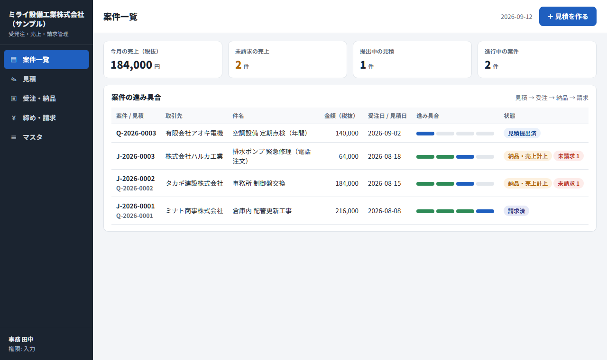

# order-invoice-manager

[](https://github.com/Mxhlix/order-invoice-manager/actions/workflows/test.yml)

English | [日本語](#日本語)

A Google Apps Script web app that manages quotes, orders, purchase orders, sales and invoices in a single Google Sheets spreadsheet.
A few people in the company work through browser screens, from the quote all the way to issuing the invoice.



## What it does

- Case list: one row per case showing how far it has progressed, from quote to invoice. It also shows this month's sales and the number of uninvoiced items.
- Quotes: pick line items from the item master, compute totals per tax rate, and save. Editing a saved quote keeps it as a revision (version + 1).
- Orders: confirm an order from a quote. Orders without a quote, such as phone orders, can be registered as direct orders.
- Purchase orders: register a purchase order to a supplier linked to a case, and output the purchase order document.
- Delivery and sales: record all or part of the order amount as sales.
- Closing and invoicing: when you specify a closing day, it first lists what will be invoiced. You review it, then issue the invoices.
- Masters: register users and permissions (admin, edit, view) from the UI. Clients (closing day, payment terms, billing method) and items can only be listed in the UI.
- Document output history: every time a quote, purchase order or invoice is output, the date and time, number and user are recorded.

## Design notes

- Consumption tax is rounded down once per tax rate. Rounding per line makes the total drift, so it follows the rounding rule of Japan's qualified invoice system.
- Numbering and invoice issuing happen under a lock. Even if two people save at the same time, the same number is never assigned twice. Right before issuing, it removes again any sales that someone else has already invoiced.
- Closing days that have not arrived yet cannot be closed. You cannot pick a closing day later than today. Sales whose closing day is still in the future are listed as "not included this time" with a reason.
- The same invoice is never issued twice. Invoiced sales get an invoice number and drop out of the next closing run. Reopening an issued invoice is recorded in the history as a redisplay, not a reissue.
- Accidental duplicate entries are stopped. A quote with the same client, same subject and same date is held with a warning, and a person chooses whether it is a revision or a separate case.
- Input errors are all returned at once. This saves the trouble of fixing one error, saving, and finding the next.
- Permissions are checked on the server side. There are three levels: admin, edit and view. Functions that register or issue check permissions themselves, so calling them without going through the UI is also blocked.
- Output to the screen and to documents is escaped. HTML in a client name or item name will not run.

## Verification

There are two kinds of tests. On 2026-10-04 both passed locally (Windows 11, Node.js 24.12.0).

`npm test` runs `gas/Code.gs` on Node, on top of a mechanism that imitates Apps Script features (`harness/mock-gas.js`). The date is fixed at 2026-09-12. All 18 checks passed. They cover:

- When required fields are empty, all reasons are returned and nothing is saved
- Numbering, totals per tax rate, revisions, the duplicate warning
- Confirming an order, rejecting a double confirmation, rejecting a revision of an already-ordered quote, direct orders
- Partial and full sales recording, rejecting an amount above the remaining balance
- Calculating closing days (end of month, the 20th) and payment due dates (end of next month, end of the month after next, the 20th of next month, a number of days)
- Selecting what a closing run covers, issuing invoices, and a rerun producing 0 items
- Outputting quotes and purchase orders, and the output history
- Actions being blocked by permission level
- Sales totals by month and by client

`npm run test:ui` starts a local server and drives a real browser with Playwright. It goes through the screens in order, from creating a quote to issuing an invoice, and checks the text and amounts displayed. It also checks that the browser reports no errors at all. It passed, and 16 screenshots along the way were saved to `harness/out/shots/`.

GitHub Actions is configured to run `npm test` on Node.js 18, 20 and 22, and `npm run test:ui` on Node.js 22.

## Getting started

Running it locally needs Node.js 18 or later. No Google account is needed.

```
npm install
npm test                                 # automated tests for Code.gs (18 checks)
npx playwright install chromium          # first time only: install the browser for the UI test
npm run test:ui                          # end-to-end UI test
npm run serve                            # open the UI at http://localhost:8787
```

`npm run serve` keeps the ledger in memory and saves documents as HTML, not PDF, to `harness/out/pdf/`.
You can start it with a different user and date, for example `node harness/server.js --user demo-admin@example.jp --now 2026-09-12`.

To put it in a Google environment, use clasp (the official command-line tool for Apps Script). The rough steps are:

1. Install clasp and log in with your Google account.
2. With clasp, create a new spreadsheet and a script bound to it. Specify `gas/` as the script's location.
3. Push the contents of `gas/` with clasp.
4. In the Apps Script editor, deploy it as a web app from "Deploy" and open the URL shown.

The exact clasp command options change between versions, so follow clasp's official documentation.

The ledger sheets are created the first time you open it. While `CONFIG.DEMO_MODE` in `Code.gs` is `true`, sample data is inserted as well. For real use, set it to `false` and register the first admin in the users sheet.
In `gas/appsscript.json`, the web app is limited to the same Google Workspace domain. This is because permissions are decided by the signed-in user's email address.

## Project layout

```
gas/
  Code.gs            server-side logic (ledger read/write, numbering, closing, documents)
  Index.html         UI
  app_js.html        UI behavior
  style_css.html     UI styling
  appsscript.json    Apps Script settings (time zone, permissions, web app)
harness/
  mock-gas.js        imitation of Apps Script features
  load-code.js       loads and runs Code.gs
  run-tests.js       automated tests (npm test)
  server.js          local server for checking (npm run serve)
  ui-smoke.js        end-to-end UI test
  run-ui.js          starts the server and runs the UI test (npm run test:ui)
docs/                screenshots
```

## Not yet verified

- The tests in this repository run on top of a mechanism that imitates Apps Script features. As of writing this README, behavior in a real Google environment (HTML to PDF conversion, saving to Drive, getting the signed-in user's email address) has not been verified.
- Speed once the ledger grows beyond a few thousand rows has not been measured.
- There is no UI for registering clients, items or your own company details. Server-side functions for saving clients and items exist (`apiSaveClient`, `apiSaveItem`), but the UI does not call them and they are not tested. For now, the assumption is that you write directly into the spreadsheet's sheets.

## License

MIT. See [LICENSE](LICENSE).

---

## 日本語

見積・受注・発注・売上・請求を、1つの Google スプレッドシートで管理する Google Apps Script の Web アプリです。
見積から請求書の発行までを、社内の数人がブラウザの画面から操作します。


### できること

- 案件一覧: 見積から請求まで、各案件がどこまで進んだかを1行で表示します。今月の売上と未請求の件数も出します。
- 見積: 品目マスタから明細を選び、税率ごとの合計を出して保存します。保存済みの見積を直すと、改訂版（版+1）として残ります。
- 受注: 見積から受注を確定します。見積を作らない電話注文などは、直接受注として登録できます。
- 発注: 案件に紐づけて仕入先への発注を登録し、注文書を出します。
- 納品・売上: 受注金額の全額か一部を売上として計上します。
- 締め・請求: 締め日を指定すると、請求対象を先に一覧で見せます。確認してから請求書を発行します。
- マスタ: 利用者と権限（管理・入力・閲覧）を画面から登録します。取引先（締め日・支払条件・請求方式）と品目は、画面では一覧の表示だけです。
- 帳票の出力履歴: 見積書・注文書・請求書を出すたびに、日時・番号・利用者を記録します。

### 設計で気をつけたこと

- **消費税は税率ごとに1回だけ端数を切り捨てる。** 明細ごとに丸めると合計がずれるので、インボイス制度の端数処理に合わせています。
- **番号の採番と請求書の発行は、ロックをかけてから行う。** 2人が同時に保存しても、同じ番号が付かないようにしています。発行の直前には、他の人が先に請求した売上をもう一度除きます。
- **まだ来ていない締め日は締めない。** 今日より後の締め日は指定できません。締め日がまだ先の売上は、理由を付けて「今回は対象外」に出します。
- **同じ請求を2回出さない。** 請求した売上には請求番号が付き、次の締め処理の対象から外れます。発行済みの請求書を開き直す操作は、再発行ではなく再表示として履歴に残します。
- **うっかりの二重登録を止める。** 同じ取引先・同じ件名・同じ日の見積は警告で止め、改訂か別件かを人に選ばせます。
- **入力の誤りは、まとめて全部返す。** 1つずつ直しては保存し直す手間を減らすためです。
- **権限はサーバ側で確かめる。** 管理・入力・閲覧の3段階です。登録や発行をする関数の中で権限を見るので、画面を通さずに呼んでも止まります。
- **画面と帳票への出力はエスケープする。** 取引先名や品名に HTML が入っていても実行されません。

### 検証

テストは2種類あります。どちらも 2026-10-04 に手元（Windows 11、Node.js 24.12.0）で通ることを確かめました。

`npm test` は、`gas/Code.gs` を Node の上で、Apps Script の機能を真似た仕組み（`harness/mock-gas.js`）に載せて動かします。日付は 2026-09-12 に固定しています。結果は 18項目すべて合格でした。確かめている内容は次のとおりです。

- 必須項目が空のとき、理由がすべて返って保存されないこと
- 採番、税率ごとの合計、改訂版、重複の警告
- 受注確定、二重確定の拒否、受注済み見積の改訂の拒否、直接受注
- 売上の一部計上と全額計上、残額を超える計上の拒否
- 締め日（月末締め・20日締め）と支払期限（翌月末・翌々月末・翌月20日・日数）の計算
- 締め処理の対象の選び方、請求書の発行、再実行で0件になること
- 見積書・注文書の出力と出力履歴
- 権限ごとに操作が止まること
- 月別・取引先別の売上集計

`npm run test:ui` は、ローカルサーバを起動し、Playwright で実際のブラウザを動かします。見積の作成から請求書の発行まで、画面を順に操作し、表示された文言と金額を確かめます。ブラウザ側でエラーが1件も出ないことも確かめます。結果は合格で、途中の画面16枚を `harness/out/shots/` に保存しました。

GitHub Actions では、`npm test` を Node.js 18・20・22 で、`npm run test:ui` を Node.js 22 で動かす設定にしています。

### 動かし方

手元で動かすには Node.js 18 以上が要ります。Google のアカウントは要りません。

```
npm install
npm test                                 # Code.gs の自動テスト（18項目）
npx playwright install chromium          # 初回だけ。画面テスト用のブラウザを入れる
npm run test:ui                          # 画面の通しテスト
npm run serve                            # http://localhost:8787 で画面を開く
```

`npm run serve` は、台帳をメモリ上に持ち、帳票は PDF ではなく HTML で `harness/out/pdf/` に保存します。
`node harness/server.js --user demo-admin@example.jp --now 2026-09-12` のように、利用者と日付を変えて起動できます。

Google 環境に置くときは、clasp（Apps Script をコマンドから扱う公式ツール）を使います。おおまかな手順は次のとおりです。

1. clasp を入れ、Google アカウントでログインする。
2. clasp で、新しいスプレッドシートと、それに紐づくスクリプトを作る。スクリプトの置き場所には `gas/` を指定する。
3. `gas/` の中身を clasp で送る。
4. Apps Script のエディタで「デプロイ」から Web アプリとしてデプロイし、表示された URL を開く。

clasp のコマンドの細かい指定は版によって変わるので、clasp の公式の説明に従ってください。

最初に開いたとき、台帳のシートが作られます。`Code.gs` の `CONFIG.DEMO_MODE` が `true` のあいだは、サンプルデータも入ります。実際に使うときは `false` にし、利用者シートに最初の管理者を登録してください。
`gas/appsscript.json` では、Web アプリの公開範囲を同じ Google Workspace のドメイン内にしています。ログイン中の人のメールアドレスで権限を決めるためです。

### フォルダ構成

```
gas/
  Code.gs            サーバ側の処理（台帳の読み書き・採番・締め・帳票）
  Index.html         画面
  app_js.html        画面の動き
  style_css.html     画面の見た目
  appsscript.json    Apps Script の設定（タイムゾーン・権限・Web アプリ）
harness/
  mock-gas.js        Apps Script の機能を真似た仕組み
  load-code.js       Code.gs を読み込んで動かす
  run-tests.js       自動テスト（npm test）
  server.js          ローカル確認用サーバ（npm run serve）
  ui-smoke.js        画面の通しテスト
  run-ui.js          サーバを起動して画面テストを動かす（npm run test:ui）
docs/                画面写真
```

### まだ確かめていないこと

- このリポジトリのテストは、Apps Script の機能を真似た仕組みの上で動かしたものです。本物の Google 環境での動作（HTML から PDF への変換、Drive への保存、ログイン中の人のメールアドレスの取得）は、この README を書いた時点では確かめていません。
- 台帳の行が数千行を超えたときの速さは測っていません。
- 取引先・品目・自社情報を画面から登録する機能はありません。取引先と品目を保存するサーバ側の関数（`apiSaveClient`・`apiSaveItem`）はありますが、画面から呼んでおらず、テストもしていません。今はスプレッドシートのシートに直接書き込む前提です。

### ライセンス

MIT です。[LICENSE](LICENSE) を見てください。
